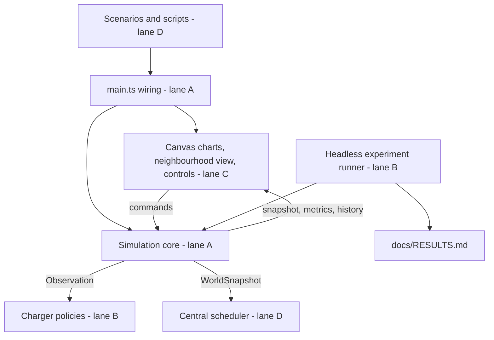

# Product and architecture specification

**Status:** working baseline 0.2. A proposal, not a record of implementation or of unanimous team agreement.
**Related:** [Contracts](CONTRACTS.md) · [Build](BUILD.md) · [Validation](VALIDATION.md)

## 1. Problem and outcome

Battery rickshaws in Bangladesh mostly charge at night, from ordinary sockets, on neighbourhood transformers that were never sized for them.

- **The load is hidden.** Drivers come home at about the same time and plug in. The chargers all draw at once, on top of the evening household peak.
- **The transformer suffers.** Voltage drops along the street, the transformer overloads, and its protection cuts the whole neighbourhood off. When power returns, every charger restarts together and it can happen again.
- **Why not a scheduler.** A central scheduler needs every charger registered, online and obedient. Much of this charging is informal, so there is nothing to register. And when the server or the network fails, every charger loses its instructions at once.

The idea brief gives these figures. **None has been checked by the team.** Lane D must find and cite a source for each before the pitch or the UI uses it (VALIDATION §6):

- BRTA estimates over 60 lakh battery-run rickshaws in the country, 10 to 12 lakh of them in Dhaka.
- In August, demand was 16,059 MW against 12,388 MW of supply, a 3,671 MW deficit.
- The Home Minister told Parliament that illegal charging costs around Tk 4,000 crore a year.
- The government is moving to register the vehicles.

**The question:** can a rule that each charger follows on its own, using only the voltage at its own socket, spread a neighbourhood's charging across the night and keep the transformer on?

**The outcome we build:** a live, pokeable simulation that answers that question with numbers, next to naive chargers and a central scheduler, and that keeps working when a judge breaks it. The picture to remember is the naive spike beside the self-spread curve.

The policy angle for the pitch: if vehicles are going to be registered anyway, a cheap "grid-friendly charger" rule is a standard that fits where policy is heading. That is an argument, not a finding.

## 2. Why this is emergent behaviour

The neighbourhood spreads its load, and no charger does.

- **No charger holds the plan.** None knows the time, how many chargers there are, what the households are using, or the transformer's rating.
- **Nothing is sent.** There are no messages, no server and no shared state. A charger learns about the others only through the voltage they jointly pull down.
- **The rules are local and fixed.** They are a few lines per charger with no training and no model.
- **The pattern is neighbourhood-wide.** A flat load curve, and the emptiest batteries being served first, are properties of the group. No line of code states either.
- **It has both feedbacks.** Spare voltage invites chargers on. Sag pushes them off, and the random delay stops them all returning together.

The same idea is used elsewhere: TCP congestion control backs senders off when the network is congested, and fireflies drift out of step through local reactions alone. Those comparisons are from memory and are checked by lane D before the pitch uses them (VALIDATION §6).

**Our test:** if any charger's code contains a clock, a schedule, a forecast or anything about another charger, it is not emergent. AGENTS.md turns this into invariants E1 to E5, and VALIDATION V02 checks them.

**Wording:** say "the load spreads itself" or "the neighbourhood flattens its own peak". Do not say each charger optimises.

## 3. Why it suits Neptune North

| Criterion | How RICKSHAWS shows it |
| --- | --- |
| Common goal | Keep the transformer on and send every rickshaw out charged |
| Independent decisions | Each charger acts on its own socket voltage and its own battery level |
| Resilience when comms fail | There are no comms to lose. Cut the power, derate the transformer or add rogue chargers and the rule keeps working. The scheduled neighbourhood reverts to the spike when its server is killed |
| Excitement | A night that plays out in seconds, with a load curve the judge can push over the limit |

Constraints from the team: emergent behaviour, not LLM-based, software only, and visual, demoable and fun. The interactive demo is the product.

## 4. Requirements

IDs stay stable across code, work items and tests.

- **R01 — neighbourhood and night.** One transformer, 200 chargers at different points along its feeder, and a household load that follows a daily curve. Each rickshaw comes home in the evening with a part-empty battery and leaves the next morning. Time runs in one-minute ticks, day after day.
- **R02 — local sensing only.** A charger decides from an `Observation` holding its own socket voltage, its battery level, whether it was drawing and how long it has been plugged in, plus its private memory. The sim core builds the observation; policies cannot reach anything else.
- **R03 — the emergent rule.** A charger backs off for a random time when its voltage sags, backs off less when its battery is emptier, and comes back when the voltage has room.
- **R04 — baselines on an identical night.** Naive, random-stagger, the local rule and a central scheduler all run on the same seed, arrivals, household load and commands.
- **R05 — voltage follows load.** Socket voltage falls as transformer load rises, and falls further at the far end of the feeder. This is the only channel between chargers.
- **R06 — a transformer that trips.** Sustained overload cuts power to the whole neighbourhood for a while. Power then returns to everything at once.
- **R07 — scheduler that can die.** The scheduler sees everything and switches every charger. When killed, its chargers fall back to charging whenever plugged in.
- **R08 — judge controls.** Heatwave (more household load), derate the transformer, sag the grid voltage, cut the power, bring a burst of rickshaws home early, remove a fraction of chargers, make a fraction stubborn, kill or revive the scheduler. Every command hits every neighbourhood identically.
- **R09 — scoreboard and load curve.** Per neighbourhood, live: the load curve against the transformer's rating, peak load, minutes overloaded, trips, minutes without power, and the share of rickshaws that left charged.
- **R10 — determinism.** The same seed, config and commands give the same metrics, so every figure can be reproduced.
- **R11 — headless experiments.** The same simulation runs without a browser over many seeds and prints the comparison table that backs the pitch.
- **R12 — honest display and repeatable demo.** The UI labels each neighbourhood, shows when the scheduler is dead, and never shows a number that did not come from the running simulation. A scripted scenario replays the judge's actions at fixed ticks for the backup video.

## 5. The rules

These are the intended behaviours. Exact thresholds and delays are tuning parameters in the policy files and start as guesses.

**The local rule, lane B, `src/policies/local.ts`**

1. After plugging in, wait a short random time before the first attempt, so chargers that arrive together do not start together.
2. While drawing, watch the socket voltage. If it falls below this charger's threshold, stop and wait a random time. Each back-off in a row makes the next wait longer, up to a cap.
3. A nearly empty battery tolerates a lower voltage and waits less. A nearly full one gives way first.
4. When the wait ends, start again only if the voltage has room for one more charger. Otherwise wait again.
5. After a power cut, wait a random time before restarting, so the neighbourhood does not come back in one step.
6. A charger may learn from its own readings, for example the highest voltage it has seen, which tells it what "no sag" looks like at its own socket. It keeps that in its private memory.

A charger knows no clock time, so it cannot follow a schedule. It may count its own ticks.

**Baselines**

- **naive** (lane B): draw whenever a rickshaw is plugged in. This is today's behaviour and makes the spike.
- **stagger** (lane B): wait a random time after plugging in, then draw without stopping. No sensing. This isolates what the voltage feedback adds over plain randomness.
- **central** (lane D): every few ticks, with the whole neighbourhood visible including each rickshaw's departure time, switch on the chargers that most need it, up to the transformer's headroom. It needs a server, a connection and registration.

**When the scheduler dies.** Its chargers charge whenever plugged in, like naive. A charger that refused to charge without instructions would strand its driver, so this is the fair fallback (BUILD D06).

## 6. Architecture



**Stack default:** TypeScript in strict mode, Vite, Canvas 2D, Vitest, Node 20 or later. No UI framework, no backend, no database, no network calls at runtime. The built site is static files, so it runs from a laptop with the Wi-Fi off. Versions are chosen by a working install in B00, not by this document.

**Planned layout, not existing files:**

```text
src/contracts.ts            shared types (exists)
src/sim/                    night, voltage, transformer, charging mechanics, metrics
src/policies/               naive, stagger, local, scheduler
src/scenarios/              presets and scripted demos
src/ui/                     charts, neighbourhood view, controls, scoreboard
src/main.ts                 wiring
scripts/experiment.ts       headless comparison
tests/{sim,policies,scheduler,scenarios,ui}/
docs/
```

One simulation instance is one neighbourhood. The UI and the experiment runner each create one instance per mode from the same config, and send every command to all of them.

## 7. The demo

1. Three neighbourhoods run the same night side by side: naive, ours, scheduled. One chart overlays their load curves against the transformer's rating.
2. Evening comes. The naive curve spikes through the rating, the transformer trips and the neighbourhood goes dark. Ours bends and stays under.
3. The judge turns on a heatwave or derates the transformer. Ours makes room again.
4. The judge cuts the power for an hour. When it returns, naive slams back on. Ours returns in a trickle.
5. The judge kills the scheduler. That neighbourhood becomes the naive one. Ours does not notice.
6. The judge makes a fifth of the chargers stubborn. Service degrades, and the scoreboard shows by how much.
7. "Isn't a random delay enough?" The presenter switches on a fourth curve, chargers that only wait a random time and sense nothing, then turns on the heatwave or cuts the power. Ours reacts because it reads the voltage. What the random-delay chargers do is whatever the run shows; the pitch claims a difference only if VALIDATION §2 clause 5 passes.

The scoreboard is on screen throughout. A night takes well under a minute at demo speed.

## 8. The product claim

**"Chargers that each watch only their own socket voltage flatten the neighbourhood's night-time peak and keep the transformer on, still send rickshaws out charged, and need no server, app or registration, so there is nothing to fail."**

Each clause is earned separately by the experiment in VALIDATION §2, and each can fail on its own. If one fails, the claim narrows to what the numbers show (BUILD §5). The scheduler is expected to do at least as well while it is alive. That is part of the story, not a problem.

Two fair objections to answer in the pitch:

- **A scheduler with a fallback rule would also survive.** Yes, and that fallback rule is our charger.
- **Chargers at the far end of the street see lower voltage, so they back off more.** This is real. The scoreboard reports near and far separately, and we say what it shows.

## 9. Not in scope

Hardware of any kind, real grid or feeder data, power-flow calculations beyond the linear sag in CONTRACTS §2, reactive power, battery ageing, tariffs or pricing, more than one transformer, accounts, a server, multiplayer, any learned or LLM-driven behaviour, and any claim about a real neighbourhood.
