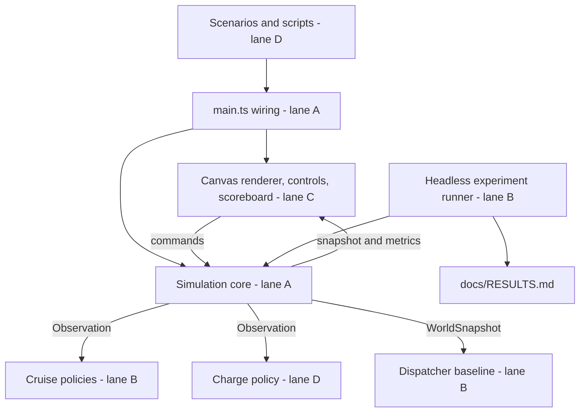

# Product and architecture specification

**Status:** working baseline 0.1. A proposal, not a record of implementation or of unanimous team agreement.
**Related:** [Contracts](CONTRACTS.md) · [Build](BUILD.md) · [Validation](VALIDATION.md)

## 1. Problem and outcome

A fleet of independent rickshaw drivers has to serve a city's passengers and share a few charging points, and no driver can see further than the street in front of them.

- **Passengers.** Demand moves all day: a train arrives, a market closes, it rains. Rickshaws bunch where fares used to be while other streets wait.
- **Charging.** If every driver charges when it suits them, they arrive together. Chargers queue at peak and sit empty off-peak, and rickshaws are off the road when they are most needed.
- **Why not a dispatcher.** Central dispatch needs every driver on one platform with a live connection. When the server or the network fails, the whole fleet loses its instructions at once.

**The question:** can simple rules that each rickshaw follows on its own produce high fleet throughput and efficient charging, with no communication at all?

**The outcome we build:** a live, pokeable simulation that answers that question with numbers, next to a random baseline and a central dispatcher, and that keeps working when a judge breaks it.

The same problem applies to any fleet working where communications are jammed or absent, such as delivery robots or drones. That is the link to Neptune North's own examples.

## 2. Why this is emergent behaviour

The fleet optimises throughput and charging, and no rickshaw does.

- **No rickshaw holds the plan.** None knows the demand map, where the rest of the fleet is, or a charging schedule.
- **Nothing is sent.** There are no messages and no shared map. A rickshaw learns about others only by seeing them on its street or in a charger queue.
- **The rules are local and fixed.** They are a few lines per rickshaw with no training and no model.
- **The pattern is fleet-wide.** Coverage that follows demand, and charging that staggers itself, are properties of the fleet. No line of code states either.
- **It has both feedbacks.** Success pulls rickshaws towards busy areas. Crowding and fading memory push them apart.

**Our test:** if any rickshaw's code contains the demand map, the fleet's positions or a schedule, it is not emergent. AGENTS.md turns this into invariants E1 to E5, and VALIDATION V02 checks them.

**Wording:** say "throughput emerges" or "the fleet optimises itself". Do not say each rickshaw optimises.

## 3. Why it suits Neptune North

| Criterion | How RICKSHAWS shows it |
| --- | --- |
| Common goal | Move as many passengers as possible and keep the fleet charged |
| Independent decisions | Each rickshaw uses its own memory and what is visible within a couple of blocks |
| Resilience when comms fail | There are no comms to lose. Remove half the fleet or close a road and service continues. The dispatched fleet stops when its server is killed |
| Excitement | A busy street map the judge can poke, with a live three-way scoreboard |

Constraints from the team: emergent behaviour, not LLM-based, not search and rescue, and visual, demoable and fun.

## 4. Requirements

IDs stay stable across code, work items and tests.

- **R01 — city and demand.** A street grid with passengers who appear at junctions and want to reach another junction. Demand has a uniform base rate plus time-limited hotspots. Passengers give up after a set wait.
- **R02 — local sensing only.** A rickshaw decides from an `Observation` limited to `sightBlocks` along streets, plus its private memory. The sim core builds the observation; policies cannot reach anything else.
- **R03 — the emergent cruising rules.** An empty rickshaw goes to a passenger it can see, otherwise leans towards places it remembers recent fares, leans away from streets with visible empty rickshaws, and keeps a little randomness.
- **R04 — baselines on identical demand.** Random wander, sight-only, the local rules and a central dispatcher all run on the same seed, map, demand and commands.
- **R05 — dispatcher that can die.** The dispatcher has full knowledge and assigns every job. When killed, its rickshaws finish the job in hand and then take no more.
- **R06 — judge controls.** Drop a crowd at a junction, close or reopen a road, remove a fraction of the fleet, make a fraction "blind", take a charger offline, kill or revive the dispatcher. Every command hits every fleet identically.
- **R07 — scoreboard.** Passengers delivered per simulated minute, mean wait, empty-distance share, and when charging is on, charger queue time and rickshaws run flat. Shown live per fleet.
- **R08 — charging.** Batteries drain with distance. Chargers have a fixed number of plugs and a queue. Each rickshaw decides when to charge from its own battery level, its own threshold and the queues it can see.
- **R09 — determinism.** The same seed, config and commands give the same metrics, so every figure can be reproduced.
- **R10 — headless experiments.** The same simulation runs without a browser over many seeds and prints the comparison table that backs the pitch.
- **R11 — honest display.** The UI labels each fleet, shows when the dispatcher is dead, and never shows a number that did not come from the running simulation.
- **R12 — repeatable demo.** A scripted scenario replays the judge's actions at fixed ticks, for the backup video and for anyone who has to present.

## 5. The rickshaw's rules

These are the intended behaviours. Exact weights are tuning parameters in the policy files and start as guesses.

**Cruising (empty), lane B, `src/policies/local.ts`**

1. If a waiting passenger is visible, head for the nearest. The first rickshaw to arrive takes the fare.
2. Otherwise score each open exit:
   - add for remembered pickups in that direction, weighted by how recent they were;
   - subtract for each empty rickshaw visible that way;
   - add a small random term.
3. Take the best exit. If there are none, wait.
4. Memory is private. A pickup strengthens the memory of that junction. Arriving to find the passenger gone weakens it. All memory fades with time.

**Carrying.** The sim core drives the shortest open route to the destination. Knowing the street map is allowed. Knowing the demand or the fleet is not.

**Charging, lane D, `src/policies/charging.ts`**

1. Each rickshaw draws its own "go and charge" battery level once, at random within a band, and keeps it.
2. Below that level, head for the nearest known charger.
3. At a charger, if the visible queue is long and the battery is not critical, leave and try again later.
4. Passing a charger with a free plug, top up early if the battery is below a higher "opportunistic" level.

**Baselines**

- **random:** pick a random open exit. It still takes a fare if it lands on one.
- **sight:** rule 1 above, otherwise random. This isolates what memory and crowd-avoidance add.
- **dispatcher:** every few ticks, with the whole world visible, assign the nearest free rickshaw to the longest-waiting passenger, and send low batteries to free plugs.

## 6. Architecture



**Stack default:** TypeScript in strict mode, Vite, Canvas 2D, Vitest, Node 20 or later. No UI framework, no backend, no database, no network calls at runtime. The built site is static files, so it runs from a laptop with the Wi-Fi off, which is itself part of the pitch. Versions are chosen by a working install in B00, not by this document.

**Planned layout, not existing files:**

```text
src/contracts.ts            shared types (exists in this pack)
src/sim/                    world, movement, demand, charging mechanics, observations, metrics
src/policies/               random, sight, local, dispatcher, charging
src/scenarios/              demand presets and scripted demos
src/ui/                     renderer, controls, scoreboard
src/main.ts                 wiring
scripts/experiment.ts       headless comparison
tests/{sim,policies,charging,scenarios,ui}/
docs/
```

One simulation instance is one fleet. The UI and the experiment runner each create one instance per mode from the same config, and send every command to all of them.

## 7. The demo

1. Three fleets run side by side on the same city: random, ours, dispatched.
2. The judge taps a junction and a crowd appears, as if a train has arrived. Ours flows towards it.
3. The judge closes a road and removes half of every fleet. Service thins and continues.
4. The judge kills the dispatcher. That fleet finishes its jobs and stops. Ours does not notice.
5. With charging on, the judge takes a charger offline and the queues spread across the others.

The scoreboard is on screen throughout.

## 8. The product claim

**"A fleet following a few local rules, with no communication, clearly beats random wandering, comes close to a central dispatcher, and keeps working when the dispatcher dies."**

Each clause is earned separately by the experiment in VALIDATION §2, and each can fail on its own. If one fails, the claim narrows to what the numbers show (BUILD §5). The live dispatcher is expected to win on raw throughput. That is part of the story, not a problem.

A fair objection to answer in the pitch: a dispatched fleet with a fallback rule would also survive. Yes, and that fallback rule is our fleet.

## 9. Not in scope

Real map data or tiles, real rickshaw or charging data, traffic congestion and collisions, pricing, driver income, multiple vehicle types, accounts, a server, multiplayer, any learned or LLM-driven behaviour, and any claim about a real city.
